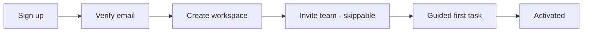

# UX Process

## Research (lightweight, SaaS-appropriate)
- 5 user interviews catch most major usability issues. Ask about past behavior, not opinions.
- Sources: support tickets, session recordings, funnel analytics, sales call notes.
- **Persona (short)**: role, goals, frustrations, tech comfort, frequency of use, key tasks. Base on real data; mark proto-personas as assumptions.
- **Jobs-to-be-done**: "When [situation], I want to [motivation], so I can [outcome]."

## Information architecture
- Group by user mental model, not org chart or DB tables.
- Typical SaaS nav: left sidebar (5-8 top-level items) + top bar (search, workspace switcher, notifications, profile). Settings and billing live under profile/settings, not primary nav.
- Depth: aim for ≤3 clicks to any frequent task. Add global search / command palette (Cmd+K) for power users.

## Flows
Write as: Trigger → Steps → Decision points → Success → Failure paths. Mermaid example:

## Onboarding (activation)
- Goal: shortest path to first value ("aha moment"), not feature tour.
- Ask only what's needed now; defer the rest. Allow skip. Show progress.
- Use sample data / templates to avoid blank-slate. Checklist (3-5 items) beats modal tours.
- Measure: time-to-first-value, activation rate, drop-off per step.

## Validate
Usability test with 5 users on key tasks; track task success, time, errors. A/B test only with enough traffic. Iterate.
